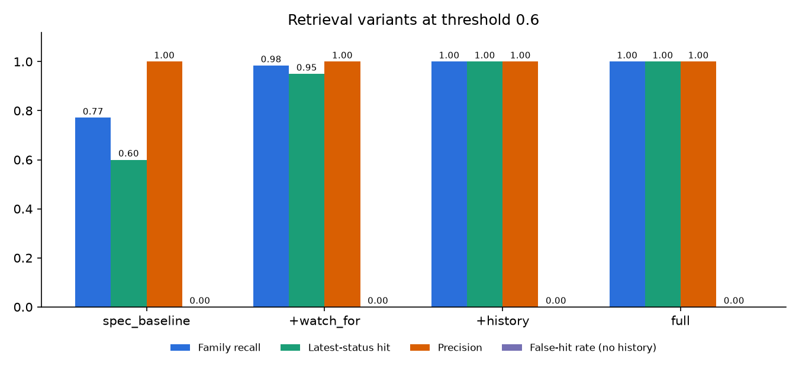
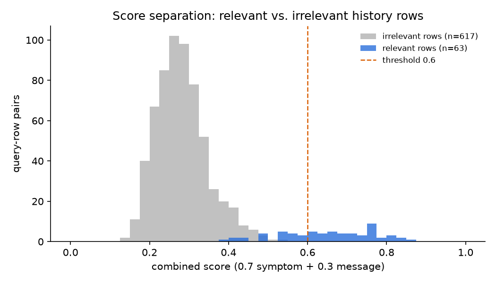
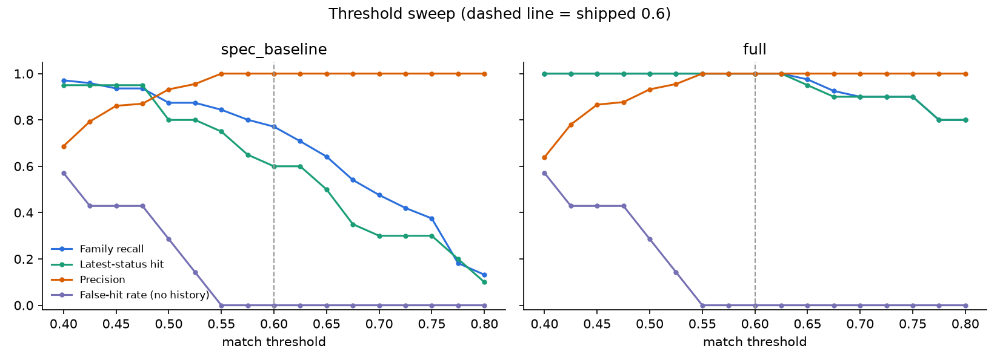
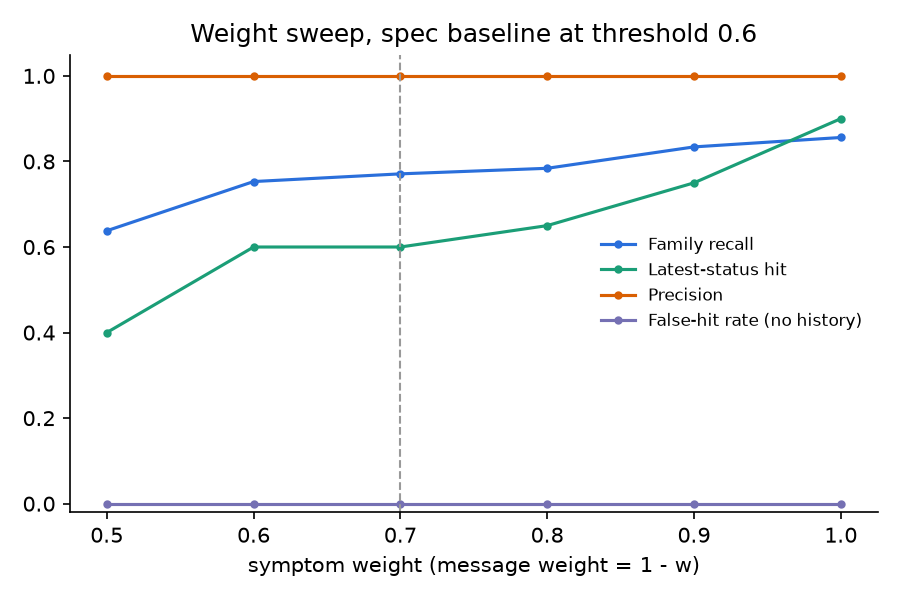

# Retrieval experiment

A small, labeled experiment on the longitudinal retrieval in
`assistant_app/retrieval.py`. It asks two questions:

1. Does the spec's scoring (`0.7 × symptom similarity + 0.3 × message
   similarity > 0.6`) find a symptom's full history, including its most recent
   status?
2. Do the two additions (an exact watch-for match, and expanding a matched
   symptom to its full history) fix what it misses without adding false hits?

```
python retrieval_eval/run_experiment.py
```

It runs the production `search_statuses` in a throwaway test database (the
development `db.sqlite3` is never touched) and writes `results/`. Embeddings
come from the configured OpenAI model and are cached in
`embedding_cache.json`, so re-runs and sweeps cost nothing and give the same
numbers. Delete the cache to re-embed (for example after changing the
embedding model).

## Dataset

`dataset.json` is one patient's history over about six months: 26 status rows
in 12 symptom families, plus 2 rows for a second patient that must never be
returned. It is built to be hard in the ways real history is:

- One symptom, many wordings: the swelling family is "swelling", "ankle
  swelling", "puffy ankles", and "leg edema".
- Resolutions that don't name the symptom: "My legs are back to normal now.",
  "That settled down after a few days of the inhaler."
- Denials that must still be retrieved as history ("No chest pain at all").

There are 27 queries, given the way the workflow builds them (label,
keywords, aligned watch-for, and context), so retrieval is tested apart from
symptom extraction:

- 20 with history: paraphrases, check-in item queries (context is the item's
  guidance, not the patient's message), a follow-up answer with a weak context
  ("It started yesterday, pretty mild."), and a two-symptom message.
- 7 without history: symptoms never reported (confusion) and look-alike
  distractors (headache, itchy eyes, back pain, chest congestion, a swollen
  eyelid).

Every row of a query's family is relevant; the family's most recent row by
clinical time is its current status. Rows from related families (for example
wheeze for a breathing query) are marked acceptable and don't count against
precision.

## Metrics

| Metric | Meaning |
|---|---|
| Family recall | Share of the family's history rows returned |
| Latest-status hit | Whether the family's most recent row was returned (the spec's "newest mention is not the newest status" case) |
| Precision | Share of returned rows that are relevant or acceptable |
| False-hit rate | Share of no-history queries that returned anything unrelated |
| Other-patient leaks | Rows from the second patient returned (must be 0) |

## Results

| Variant (threshold 0.6) | Family recall | Latest-status hit | Precision | False-hit rate | Leaks |
|---|---|---|---|---|---|
| spec_baseline | 0.77 | 0.60 | 1.00 | 0 | 0 |
| +watch_for | 0.98 | 0.95 | 1.00 | 0 | 0 |
| +history | 1.00 | 1.00 | 1.00 | 0 | 0 |
| full (shipped) | 1.00 | 1.00 | 1.00 | 0 | 0 |



**The spec's scoring is precise but misses history, especially the current
status.** It returned nothing irrelevant, but found only 77% of history rows
and the most recent status for only 60% of queries. The misses are the rows
that matter most: resolutions and differently worded reports. "My legs look
puffy" found 2 of 5 swelling rows and missed the latest "back to normal"; the
follow-up answer "It started yesterday, pretty mild" found 1 of 5.

**The threshold is well placed for rejecting noise but can't also catch all
relevant rows.** Irrelevant pairs peak around 0.28 and never exceed 0.543;
relevant pairs have a median of 0.657, but a third fall below 0.6.



Lowering the threshold doesn't fix this: the baseline starts returning
distractors below 0.55 (57% false-hit rate at 0.40) while still missing the
latest status. With the watch-for match and history expansion, recall and
latest-status hit stay at 1.00 across 0.40–0.625 and precision is 1.00 from
0.55 up, so 0.6 sits inside a stable range rather than on an edge.



**The message term costs recall here.** At threshold 0.6, the baseline's
latest-status hit rises from 0.60 at the spec's 0.7/0.3 weighting to 0.90 with
symptom similarity alone, because a resolution's wording rarely resembles the
new complaint. The shipped version keeps 0.7/0.3 (it is in the spec, and it
still ranks results), and history expansion means the message term can no
longer drop a row that belongs to a matched symptom.



`results/summary.md` has the full sweep tables and per-query results for both
the baseline and the shipped version; `results/metrics.json` has the raw data.

## Caveats

- Small and hand-built: 27 queries and 26 rows written for this experiment.
  The perfect scores for the shipped version show it handles these cases,
  not that it is perfect in general.
- The watch-for match and history grouping assume the symptom agent aligned
  each row to the right watch-for. The dataset's alignments are correct by
  construction; in the app they come from the model (covered separately by
  `eval/run_eval.py`). An end-to-end version would run each query message
  through the symptom agent first.
- Rows outside the watch-fors group only by identical label. Here "rash" and
  "arm rash" were each found by the score alone, so expansion was not needed
  for them; a differently worded non-watch-for history could still be split.
